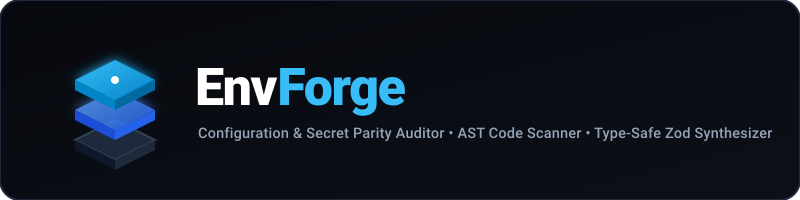
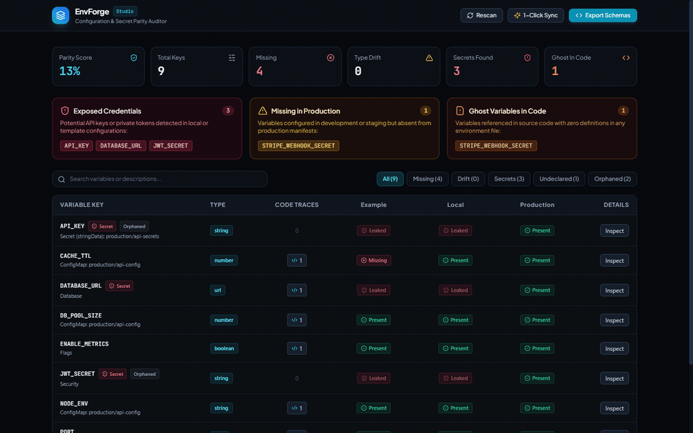
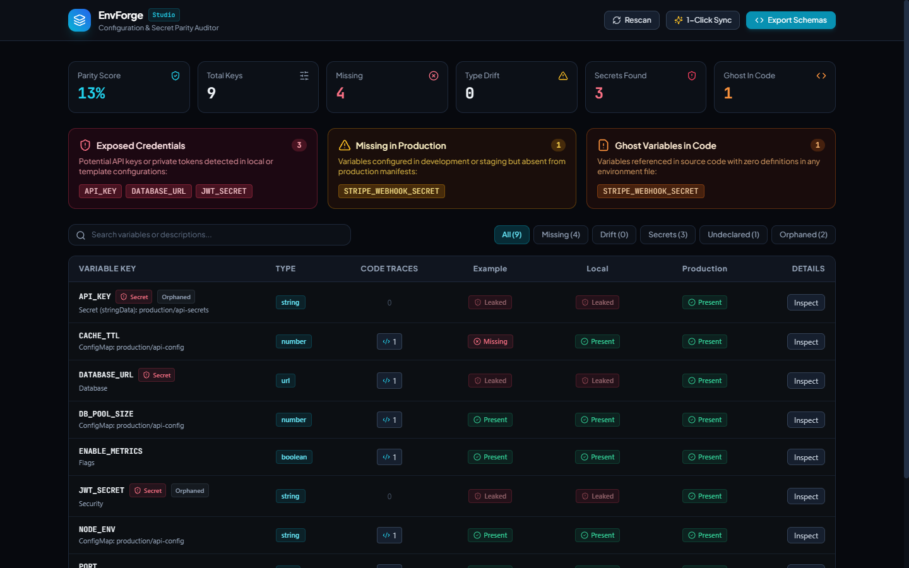
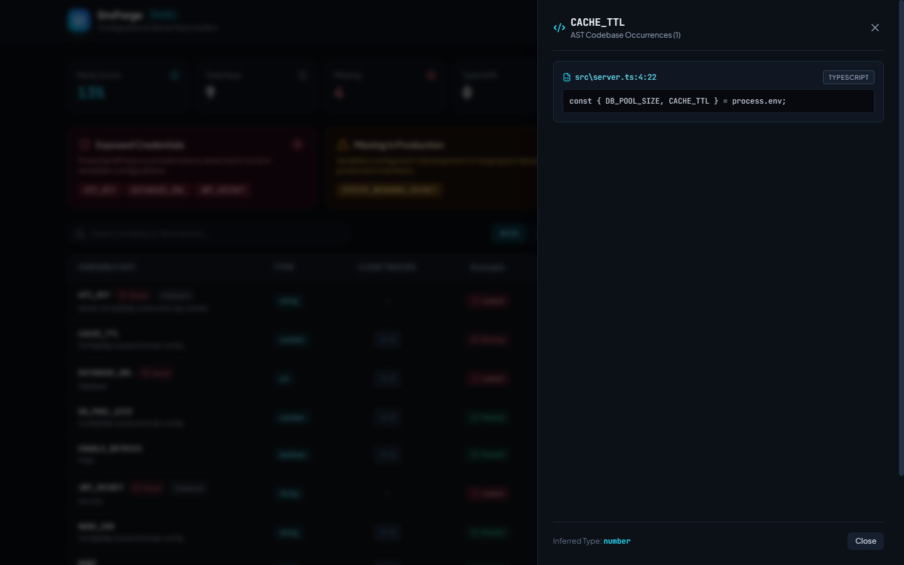
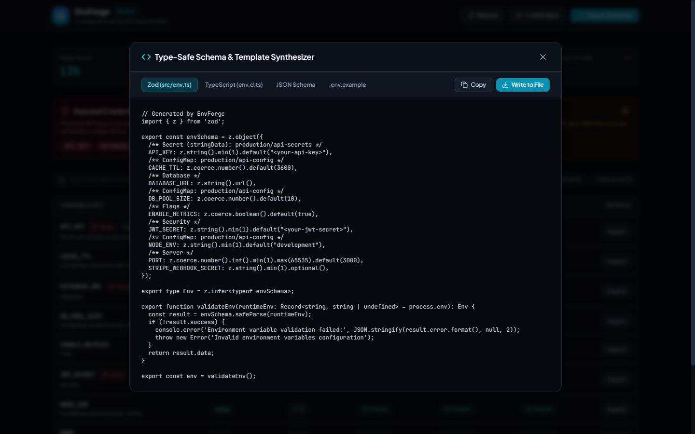
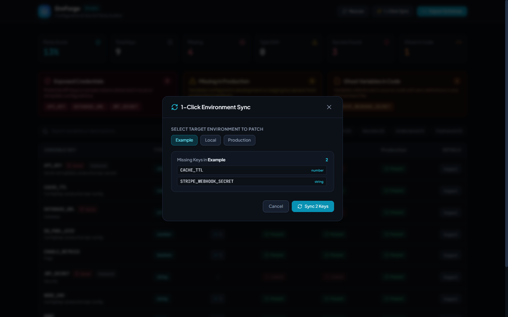

<p align="center">
  
</p>

<p align="center">
  <strong>Cross-Environment Configuration and Secret Parity Auditor with Drift Detection and Type-Safe Schema Generation</strong>
</p>

<p align="center">
  <a href="https://github.com/alexandrmotologa/envforge/actions"></a>
  <a href="https://nodejs.org"></a>
  <a href="https://www.typescriptlang.org"></a>
  <a href="https://react.dev"></a>
  <a href="https://zod.dev"></a>
  <a href="LICENSE"></a>
</p>

---

## Overview

EnvForge audits environment configurations across multiple formats and execution tiers. It resolves configuration discrepancies by providing:

1. **Multi-Format Configuration Ingestion**: parses `.env.*`, `docker-compose.yml`, Kubernetes ConfigMaps and Secrets, and Terraform `.tfvars`.
2. **Cross-Environment Parity Matrix**: constructs a unified alignment grid across Local, Development, Staging, and Production environments, classifying missing, drifted, and type-mismatched keys.
3. **AST Codebase Reference Scanner**: parses TypeScript, JavaScript, Python, and Go source code to track exact variable usage, flagging ghost variables used in code but absent from configuration templates.
4. **Secret Leak Detection**: calculates Shannon entropy and validates against deterministic token signatures to prevent accidental exposure of production credentials in local or example files.
5. **Type-Safe Schema Synthesizer**: automatically generates executable Zod validation modules, TypeScript `ProcessEnv` declarations, JSON Schemas, and sanitized `.env.example` templates.
6. **CI Gating and Interactive Studio**: blocks pull requests on drift using strict exit codes, or provides an interactive web studio with 1-click synchronization.

---

## Demo

<p align="center">
  
</p>

---

## Visual Studio Highlights

<p align="center">
  
  <em>Figure 1: Cross-environment parity grid with real-time status indicators and drift alerts.</em>
</p>

<p align="center">
  
  <em>Figure 2: AST code reference drawer displaying exact file paths, line numbers, and context snippets.</em>
</p>

<p align="center">
  
  <em>Figure 3: Live schema code generator for Zod, TypeScript, JSON Schema, and sanitized templates.</em>
</p>

<p align="center">
  
  <em>Figure 4: 1-Click synchronization dialog to align missing keys across environments.</em>
</p>

---

## Installation

### Global or NPX Execution
```bash
npx envforge check --strict
```

### Local Project Dependency
```bash
npm install -D envforge
```

---

## CLI Reference

### 1. Parity Check (CI/CD Gating)
Evaluate configuration consistency and exit with non-zero status when violations occur:
```bash
# General parity check
npx envforge check

# Fail pull requests if variables are missing in production or types drift
npx envforge check --fail-on-drift

# Fail if plaintext credentials or high-entropy tokens are exposed in non-production files
npx envforge check --fail-on-secrets

# Strict mode: fail on drift, secrets, or undeclared ghost variables
npx envforge check --strict --path ./services/api
```

### 2. Comprehensive Diagnostic Audit
Print a formatted parity table directly in the terminal:
```bash
npx envforge audit
```

Export structured audit reports for CI pipelines:
```bash
# JSON output
npx envforge audit --json > parity-audit.json

# Markdown output
npx envforge audit --markdown > PARITY_REPORT.md
```

### 3. Codebase AST Reference Scan
Find all locations where environment variables are referenced in source files:
```bash
npx envforge scan --path ./src
```

Output:
```
🔍 Scanning source code AST in /workspace/src...

Found 7 distinct environment variables referenced in code:

  CACHE_TTL (1 references)
    src/server.ts:4:22 -> const { DB_POOL_SIZE, CACHE_TTL } = process.env;
  DATABASE_URL (1 references)
    src/server.ts:3:14 -> const dbUrl = process.env.DATABASE_URL;
  PORT (1 references)
    src/server.ts:1:13 -> const port = process.env.PORT || 3000;
  STRIPE_WEBHOOK_SECRET (1 references)
    src/server.ts:8:21 -> const stripeSecret = process.env.STRIPE_WEBHOOK_SECRET;
```

### 4. Schema Generation
Synthesize ready-to-use validation files:
```bash
# Generate strict Zod validation module
npx envforge generate --schema zod --out src/env.ts

# Generate TypeScript global declarations
npx envforge generate --schema typescript --out src/env.d.ts

# Generate JSON Schema
npx envforge generate --schema json --out .env.schema.json

# Generate sanitized .env.example with masked secrets
npx envforge generate --schema example --out .env.example
```

### 5. 1-Click Synchronization
Append missing keys from other environments to a target file:
```bash
# Preview missing keys
npx envforge sync --target example --dry-run

# Patch missing keys into .env.example
npx envforge sync --target example

# Patch missing keys into staging configuration
npx envforge sync --target staging --file .env.staging
```

### 6. Interactive Web Studio
Launch the local web studio with visual parity grid and live AST explorer:
```bash
npx envforge studio --port 4300
```
Open your browser at `http://localhost:4300`.

---

## Generated Code Examples

### Zod Schema Output (`src/env.ts`)
```typescript
// Generated by EnvForge
import { z } from 'zod';

export const envSchema = z.object({
  /** HTTP server listening port */
  PORT: z.coerce.number().int().min(1).max(65535).default(3000),
  /** PostgreSQL connection URI */
  DATABASE_URL: z.string().url(),
  /** Enable debug telemetry */
  DEBUG: z.coerce.boolean().default(false),
  /** Secret API token */
  JWT_SECRET: z.string().min(1).default("<your-jwt-secret>"),
  /** Webhook signing key */
  STRIPE_WEBHOOK_SECRET: z.string().min(1).optional(),
});

export type Env = z.infer<typeof envSchema>;

export function validateEnv(runtimeEnv: Record<string, string | undefined> = process.env): Env {
  const result = envSchema.safeParse(runtimeEnv);
  if (!result.success) {
    console.error('Environment variable validation failed:', JSON.stringify(result.error.format(), null, 2));
    throw new Error('Invalid environment variables configuration');
  }
  return result.data;
}

export const env = validateEnv();
```

---

## Programmatic API

EnvForge can be used programmatically in Node.js applications and custom test suites:

```typescript
import {
  discoverEnvironmentSources,
  scanCodebase,
  buildParityMatrix,
  generateZodSchema,
} from 'envforge';

// 1. Discover all configuration sources
const sources = await discoverEnvironmentSources(process.cwd());

// 2. Scan source code AST
const codeRefs = await scanCodebase(process.cwd());

// 3. Compute cross-environment parity matrix
const report = buildParityMatrix(sources, codeRefs);

console.log(`Parity Score: ${report.summary.parityScore}%`);
console.log(`Missing Keys: ${report.summary.missingVariablesCount}`);
console.log(`Secrets Exposed: ${report.summary.secretCount}`);

// 4. Generate Zod schema
const zodCode = generateZodSchema(report.rows);
```

---

## Architecture

For an in-depth explanation of AST visitor algorithms, Shannon entropy detection formulas, and parser specifications, read [ARCHITECTURE.md](docs/ARCHITECTURE.md).

---

## Testing

Run the automated test suite covering all parsers, AST visitors, secret detection rules, and schema synthesizers:
```bash
npm test
```

---

## License

MIT License. Authored by Alexandr Motologa.
