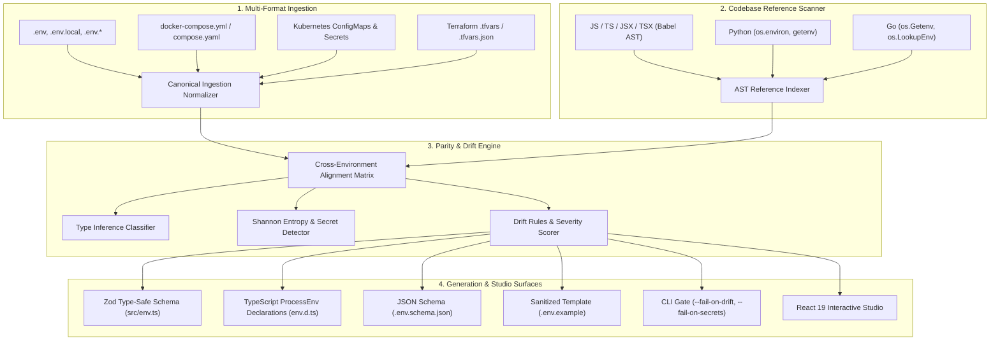

# EnvForge Architecture Specification

This document details the internal architecture, parsing pipelines, static AST analysis, drift detection rules, and schema synthesis mechanics of EnvForge.

## 1. System Pipeline Overview

EnvForge operates as a multi-stage static analysis engine:



## 2. Ingestion Engine

The ingestion pipeline normalizes configuration inputs from disparate file formats into canonical records:

```typescript
export interface EnvEntry {
  key: string;
  value: string;
  rawValue: string;
  type: InferredType;
  sourceFile: string;
  format: ConfigFormat;
  line?: number;
  comment?: string;
  isSecretCandidate?: boolean;
}
```

### Supported Formats
1. **Dotenv (`src/parsers/dotenv.ts`)**:
   - Parses multi-line quoted strings (double quotes expand escape characters, single quotes preserve literals).
   - Extracts preceding line comments and inline comments.
   - Resolves variable expansion patterns such as `${VAR}` and `${VAR:-fallback}`.
   - Supports `export` declarations.
2. **Docker Compose (`src/parsers/compose.ts`)**:
   - Parses service definitions using YAML AST traversal.
   - Extracts both array format (`- KEY=val`) and mapping format (`KEY: val`).
   - Identifies active services associated with each variable.
3. **Kubernetes Manifests (`src/parsers/kubernetes.ts`)**:
   - Processes multi-document YAML manifests (`---`).
   - Extracts plaintext values from `v1/ConfigMap` (`data`).
   - Automatically decodes base64 payload strings from `v1/Secret` (`data`) and ingests plaintext values from `stringData`.
4. **Terraform (`src/parsers/terraform.ts`)**:
   - Parses HCL2 assignment syntax (`variable = "value"`), numbers, booleans, and lists.
   - Supports `.tfvars.json` input maps.

## 3. Codebase Reference AST Scanner

The AST scanner inspects application source code to discover environment variable lookups:

1. **TypeScript and JavaScript (`src/scanner/js_scanner.ts`)**:
   - Parses code with `@babel/parser` using plugins for TypeScript, JSX, dynamic imports, and `import.meta`.
   - Traverses `MemberExpression` nodes for `process.env.VAR`, `process.env['VAR']`, and `import.meta.env.VITE_VAR`.
   - Traverses `OptionalMemberExpression` nodes for `process.env?.VAR`.
   - Traverses `VariableDeclarator` nodes for destructuring patterns: `const { PORT, DB_URL } = process.env;`.
   - Captures source file paths, line numbers, column offsets, and context code lines.
2. **Python (`src/scanner/python_scanner.ts`)**:
   - Evaluates `os.environ["VAR"]`, `os.environ.get("VAR")`, and `os.getenv("VAR")`.
   - Disregards commented lines.
3. **Go (`src/scanner/go_scanner.ts`)**:
   - Evaluates `os.Getenv("VAR")` and `os.LookupEnv("VAR")`.
4. **Ghost Reference Detection**:
   - Compares the set of all variables referenced in code against variables declared in configuration files.
   - Variables referenced in code with zero declarations in any environment are flagged as `UNDECLARED` (ghost variables).

## 4. Secret Detection and Shannon Entropy Analysis

To prevent accidental exposure of production credentials in local development files or templates, EnvForge applies a two-tier secret evaluation pipeline:

### Deterministic Regex Rules
- AWS IAM Access Key ID (`AKIA[0-9A-Z]{16}`)
- Stripe API Secret Keys (`sk_live_...`, `sk_test_...`)
- OpenAI API Keys (`sk-proj-...`, `sk-...`)
- GitHub Personal Access Tokens (`ghp_...`, `github_pat_...`)
- Slack OAuth Bot and User Tokens (`xoxb-...`, `xoxp-...`)
- RSA and OpenSSH Private Key headers (`-----BEGIN ... PRIVATE KEY-----`)
- JWT Tokens (`eyJ...`)
- Database connection strings containing embedded passwords

### Shannon Entropy Formula
For variable names containing credential indicators (`SECRET`, `TOKEN`, `PASSWORD`, `API_KEY`), EnvForge computes Shannon entropy:

$$H(X) = -\sum_{i=1}^{n} P(x_i) \log_2 P(x_i)$$

Strings with length equal to or greater than 20 characters exhibiting entropy higher than 3.8 are flagged as high-entropy credentials. Masked representations (such as `sk-p****cdef`) are generated for display to prevent exposing sensitive tokens.

## 5. Cross-Environment Parity Matrix and Drift Rules

Each variable is aligned into a matrix where rows represent variable names and columns represent environments. Each cell is assigned a status:

- `OK`: Variable is declared with consistent type across environments.
- `MISSING`: Variable exists in some environments but is omitted in this environment.
- `TYPE_MISMATCH`: Variable type differs (for example, numeric port in local, boolean in staging).
- `SECRET_EXPOSED`: Plaintext credential detected in a non-production configuration (local, development, example, test).
- `ORPHANED`: Variable declared in configuration files but never referenced across source code.
- `UNDECLARED`: Variable referenced in code but missing from all configuration files.

### Parity Score Formula
The composite parity score (0 to 100%) measures overall environment alignment:

$$\text{Score} = \max\left(0, 100 - \frac{\sum \text{Penalties}}{\text{Total Cells}} \times 100\right)$$

Penalties apply for missing keys (1.0), exposed secrets (2.0), type mismatches (1.5), and undeclared code lookups (1.5).

## 6. Type-Safe Schema Generation

From the verified parity matrix, EnvForge synthesizes production validation code:
- **Zod (`src/generator/zod.ts`)**: generates `envSchema` with `z.coerce.number().int().min(1).max(65535)` for ports, `z.string().url()` for URIs, `z.coerce.boolean()` for boolean flags, and optional markers for non-uniform keys.
- **TypeScript (`src/generator/typescript.ts`)**: generates global `NodeJS.ProcessEnv` interface augmentations for IDE code completion.
- **JSON Schema (`src/generator/json_schema.ts`)**: produces draft-07 `.env.schema.json` files for editor linting.
- **Example Template (`src/generator/example.ts`)**: synthesizes clean `.env.example` templates with sanitized placeholders and documented comments.
